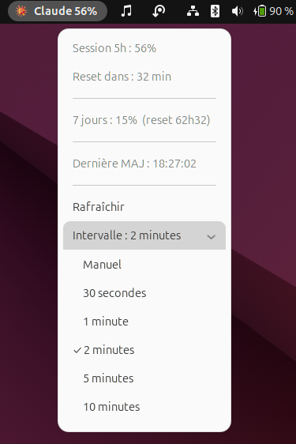

# claude-usage-indicator

Extension GNOME Shell native affichant l'utilisation Claude.ai dans la topbar.

Affiche en temps réel : session 5h (%), 7 jours (%), timer avant reset.



## Prérequis

- GNOME Shell 45, 46 ou 47 (Ubuntu 24.04 → GNOME 46)
- Compte Claude.ai connecté via Claude Code (`~/.claude/.credentials.json` présent)

## Installation

```bash
bash install.sh
```

Puis **déconnectez-vous et reconnectez-vous** (requis sous Wayland — GNOME Shell
ne peut pas être rechargé à chaud).

## Désinstallation

```bash
gnome-extensions disable claude-usage-indicator@kiboko.fr
rm -rf ~/.local/share/gnome-shell/extensions/claude-usage-indicator@kiboko.fr
```

## Débogage

```bash
# Logs de l'extension en direct
journalctl -f /usr/bin/gnome-shell --output cat | grep claude-usage

# Statut de l'extension
gnome-extensions info claude-usage-indicator@kiboko.fr

# Vérifier les erreurs JS dans Looking Glass
# Alt+F2 → lg → onglet Errors  (X11 uniquement)
```

## Fonctionnement

- Poll `https://api.anthropic.com/api/oauth/usage` toutes les 120 secondes via `Soup.Session`
- Token OAuth lu dans `~/.claude/.credentials.json` (clé `claudeAiOauth.accessToken`)
- Refresh automatique du token si `expiresAt` dépassé
